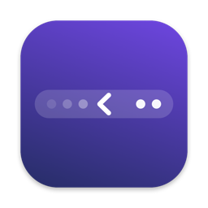

<p align="center">
  
</p>

<h1 align="center">HideBar</h1>

<p align="center">
  Hide the menu bar icons you don't need, without breaking Notification Center.
</p>

<p align="center">
  <a href="https://github.com/yxod/hidebar/releases/latest"><b>Download the latest version</b></a>
  &nbsp;·&nbsp; macOS 14 or later &nbsp;·&nbsp; best on macOS 27 and MacBooks with a notch
</p>

---

On a MacBook with a notch, only about a dozen icons fit to the right of the camera, and macOS tucks the rest behind its « button. HideBar lets you decide which icons always stay in sight and which stay hidden until you ask for them.

HideBar started as a replacement for Hidden Bar. On macOS 27, Hidden Bar hides icons by switching on the system's exam mode, and while it is on, clicking the clock no longer opens Notification Center. HideBar uses the menu bar's own overflow instead, so the clock, notifications and everything else keep working.

## Features

- **One arrow.** HideBar adds no button of its own: you use the system « that is already in the menu bar.
- **Icons appear in place.** Clicking « reveals the hidden icons right next to the others, not in a separate row at the far end of the screen.
- **They hide again on their own.** A few seconds after the pointer leaves the menu bar, the icons are tucked away again (icons revealed with « need Accessibility access for this). While you are using an icon's menu, HideBar waits.
- **Notification Center opens** with a click on the clock, any time.
- **Your order.** Hold ⌘ and drag icons: everything left of the `|` separator is hidden, everything right of it stays visible.
- **Keyboard shortcut** to show or hide all icons, **launch at login**, and **`hidebar://` links** for Shortcuts and Raycast.
- **English and Ukrainian** interface, switchable in Settings.
- **Light and private:** a native Swift app with no third-party code, no network access and no data collection.

## Installation

1. Download `HideBar-x.y.z.dmg` from [Releases](https://github.com/yxod/hidebar/releases/latest).
2. Open it and drag HideBar to Applications. The app is signed and notarized by Apple, so it opens without warnings.
3. Launch HideBar. Settings open, where you can turn on **Launch at login**.
4. Optionally, grant **Accessibility** access (the **Allow Access…** button in Settings). With it, HideBar sees exactly where every icon is, so hidden ones never slip back into the bar, and it can hide icons revealed with « on its own. Everything else works without it.

If you use Hidden Bar or a similar app, quit it first: two icon hiders get in each other's way.

## Usage

**Choose what to hide.** While the Settings window is open, the `|` separator is visible in the menu bar. Hold ⌘ and drag icons: left of `|` they will be hidden, right of it they stay visible. Close Settings and the rest disappears.

**See hidden icons.** Click the system «. The icons appear next to the others, and the `|` line shows which of them will hide again. Icons that don't fit right of the notch are placed by macOS right next to it on the left.

**Hide them again.** Click », or just move the pointer out of the menu bar: after the delay you set, HideBar hides everything on its own.

**Open Settings.** HideBar has no icon of its own, so open it again: from Spotlight (⌘Space → HideBar), Launchpad or the Applications folder. You can also right-click the `|` line while icons are revealed, or open `hidebar://settings`.

## Settings

| Setting | What it does |
|---|---|
| Launch at login | Starts HideBar together with macOS |
| Language | English or Українська; HideBar restarts to switch |
| Hide icons on launch | Hides everything left of the separator `\|` right after start |
| Show/hide shortcut | Shows all icons or hides them again from any app |
| Hide icons again automatically | How many seconds to wait before hiding revealed icons |
| Wait while the pointer is in the menu bar | Doesn't pull icons away from under your pointer |
| Accessibility | Shows whether access is granted and opens the page to grant it |
| Reset Positions | Puts the separator back next to the system icons |
| Menu Bar Settings… | Opens System Settings, where an app's icon can be removed for good |

## Permissions and privacy

- **Accessibility** is optional. With it, HideBar reads where the menu bar has placed each icon (to keep hidden ones hidden) and can press » for you to hide icons revealed with «. The pointer doesn't move, and HideBar only reads the menu bar.
- HideBar doesn't need screen recording, file access or the network. Settings stay on your Mac, and no data is sent anywhere.

## Automation

The links work from Shortcuts, Raycast, Alfred, the terminal (`open "hidebar://toggle"`) and anything else that opens URLs.

| Link | Action |
|---|---|
| `hidebar://toggle` | Show or hide the icons |
| `hidebar://show` | Show all icons |
| `hidebar://hide` | Hide the icons |
| `hidebar://settings` | Open Settings |
| `hidebar://check-for-updates` | Check for a new version |
| `hidebar://launch-at-login/on` | Turn on launch at login (`/off` turns it off) |

## FAQ

**Why do some icons appear left of the notch?**
There is little room right of the camera. Whatever doesn't fit, macOS places right next to the notch on the left. If you have too many icons, switch the ones you don't need off for good in System Settings › Menu Bar.

**After a screen recording, one hidden icon stayed visible.**
The screen recording indicator takes room next to the notch for a while, and when it goes away an icon can move into the freed space. With Accessibility access HideBar notices this and hides the icon again right away; without it, the next click on « and » sorts it out.

**Does it work on an external display or older macOS?**
Yes, but these are the least tested: HideBar was developed on macOS 27 and the built-in display of a MacBook with a notch. On displays without a notch, it fits the separator to the active app's menus by itself: exactly with Accessibility access, by trying lengths without it. On older macOS versions without the system menu bar overflow, HideBar shows its own arrow, like the classic Hidden Bar.

## For developers

```bash
./build.sh install      # build and install to /Applications
./release.sh 1.0.1      # publish a notarized release on GitHub
```

How hiding works, why Hidden Bar breaks Notification Center, building and releasing: [docs/DEVELOPMENT.md](docs/DEVELOPMENT.md).

## License

[MIT](LICENSE)
